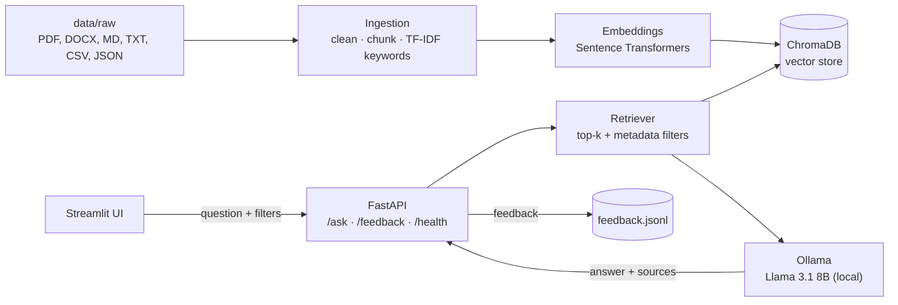
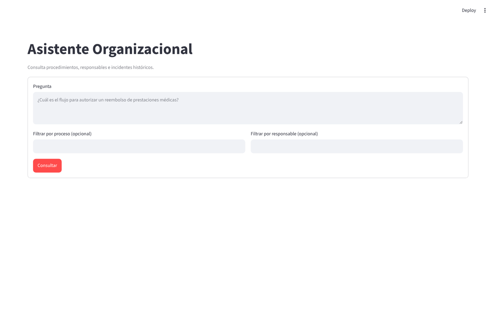
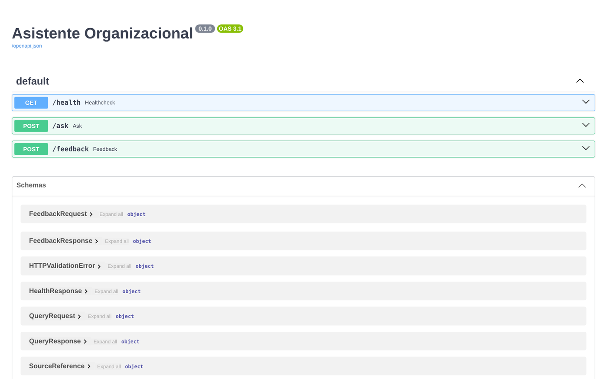

# Organizational Assistant: Local RAG for onboarding and internal procedures

A Retrieval-Augmented Generation (RAG) assistant that helps employees find answers in internal procedures, policies and past resolutions. It ingests company documents, indexes them in a local vector store, and answers questions with a local LLM, **grounded only in the retrieved context** and with references to the source documents. Everything runs on-premise: no document leaves the machine.

> Personal project (Oct–Dec 2025), built solo as an API-first evolution of the ideas behind my capstone project (a desktop RAG assistant built with a team of 3).

## Problem

In many organizations, procedural knowledge is scattered across documents and depends on a few experienced people. New employees take longer to ramp up, and the same questions get answered over and over. Sending internal documents to external AI services is often not acceptable.

## Solution

A local RAG pipeline: documents are cleaned, chunked, enriched with metadata and embedded into ChromaDB; a FastAPI service retrieves the most relevant chunks and asks a local Llama model (via Ollama) to answer using that context only. A Streamlit UI lets users ask questions, filter by process, inspect the sources, and rate each answer.

## Key features

- **Multi-format ingestion:** `.txt`, `.md`, `.pdf`, `.docx`, `.csv` and `.json`, with text cleaning and recursive chunking.
- **Metadata enrichment:** each chunk carries its source, its process (derived from the folder structure) and TF-IDF keywords, which are shown in the answer references.
- **Grounded answers:** a constrained prompt forces the model to answer only from retrieved context and to say so when the context is not enough.
- **Metadata filters:** narrow retrieval to a specific process or owner.
- **100% local and private:** Llama 3.1 8B (quantized) through Ollama and local Sentence Transformers embeddings; no external API keys.
- **REST API:** `/ask`, `/feedback` and `/health` endpoints with Pydantic schemas and auto-generated OpenAPI docs.
- **Feedback loop and evaluation:** user ratings are stored for review, and an offline evaluation script scores answers against an expected-answer dataset.
- **Operational scripts:** full re-ingestion, knowledge-base reset and an end-to-end diagnostic check.

## Tech stack

| Layer | Technologies |
|---|---|
| LLM | Ollama (Llama 3.1 8B Instruct, quantized; configurable) |
| RAG | LangChain, ChromaDB, Sentence Transformers (all-MiniLM-L6-v2) |
| API | FastAPI, Uvicorn, Pydantic / pydantic-settings |
| UI | Streamlit |
| Data processing | pandas, scikit-learn (TF-IDF), pypdf, docx2txt |
| Tooling | Typer CLI, Ruff |

## Architecture



- **Separation of concerns:** `knowledge_base` (ingestion), `rag_engine` (retrieval and generation), `service` (API), `ui` (front end) and `evaluation` (offline scoring) are independent modules.
- **Config via environment:** model, embedding model, paths and ports are set in `.env` through pydantic-settings, so the LLM can be swapped (for example `llama3.2:3b` on lighter hardware) without code changes.

## Screenshots

| Streamlit UI | REST API (OpenAPI docs) |
|---|---|
|  |  |

## How to run

**Requirements:** Python 3.10+, [Ollama](https://ollama.com) installed and running, ~8 GB RAM (16 GB recommended).

```bash
git clone https://github.com/andrynho10/mvp-asistente-ia.git
cd mvp-asistente-ia
python -m venv .venv
source .venv/bin/activate        # Windows: .venv\Scripts\activate
pip install -e .
cp .env.example .env             # Windows: copy .env.example .env

ollama pull llama3.1:8b-instruct-q4_K_M
```

Put your documents in `data/raw/` (subfolders become the "process" metadata), then:

```bash
python reingest.py                         # build the knowledge base
uvicorn src.service.app:app --reload       # API → http://localhost:8000/docs
streamlit run src/ui/app.py                # UI  → http://localhost:8501
```

Run `python test_api.py` for an end-to-end diagnostic.

## My role

Personal project, designed and built end to end by me:

- Architecture: API-first design (FastAPI service + Streamlit client), configuration via environment settings, and a CLI for re-ingestion and offline evaluation.
- RAG pipeline: multi-format ingestion, metadata enrichment, filtered retrieval and grounded prompting.
- Migrated generation from a hosted LLM API (Groq) to a fully local model with Ollama, so documents never leave the machine.
